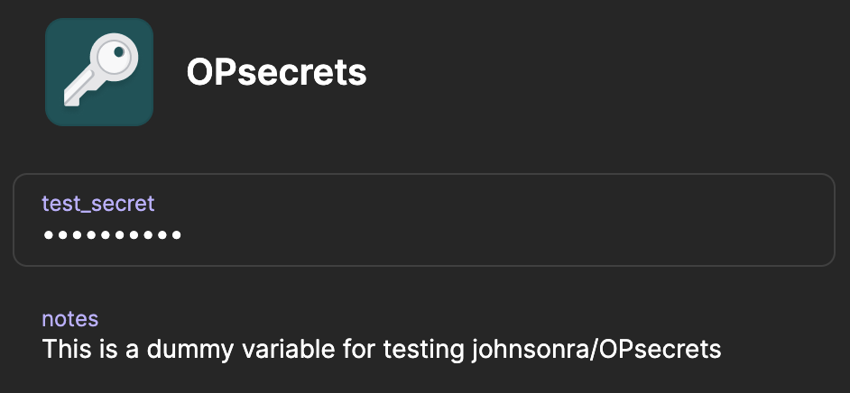
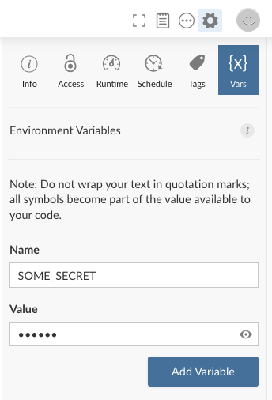

<!--
# To render the quarto file, README.qmd,
# set up required virtual environment in the terminal with

```bash
python -m venv .venv
.venv/Scripts/Activate    # (Windows)
source .venv/bin/activate # (Linux/OS X)

python -m pip install "git+https://github.com/johnsonra/OPsecrets.git@python"
```

You will also need the R package installed with

```R
remotes::install_github("johnsonra/OPsecrets", ref = "R")
```
-->

```{r setup}
#| include: false

root <- here::here()

library(OPsecrets)

library(reticulate)
use_virtualenv(file.path(root, ".venv"), required = TRUE)
py_config()
```

The `OPsecrets` package was developed because I found myself needing to retrieve API keys and other sensitive information from 1Password for various projects when I was developing Shiny dashboards on my laptop. Then when the code was deployed to a Posit server, I had to make slight changes to the code to retrieve these secrets from the local environment.

This package is designed to provide a single tool to retrieve secrets from either the environment or from 1Password using the `op` command line tool. A single call to `get_secret` can be used to retrieve secrets from an environmental variable, or if the environmental variable is undefined, from 1Password using the `op` command line tool.

This repository has implementations for both R and python on separate branches and is designed to work on Unix-like systems (e.g. Linux, macOS) and Windows, but it may require additional configuration on Windows to work with 1Password.

Both versions provide the same core workflow: look for a secret in the environment first, then fall back to 1Password through the `op` command-line tool.

## Set up the 1Password CLI

Install the 1Password `op` command-line tool before using either branch:

https://developer.1password.com/docs/cli/get-started/

After installing it, confirm that `op` is available from your terminal:

```bash
op --version
```

### Windows

If `op` is not on the default `PATH`, set the `OP` environment variable to the directory that contains the executable.

1.  First, verify that `op` works in a Windows terminal running `powershell` with `op --version` as described on the [1Password getting-started page](https://support.1password.com/command-line-getting-started/). If this doesn't work, review the instructions on the 1Password site to ensure that `op` is installed correctly.

2.  If `op` is installed correctly but `get_secret` is still having trouble finding `op`, you can set the `OP` environment variable in R to the path for the `op` executable. To find the full path on Windows, run `(Get-Command op).Source` in the `powershell` and copy the path returned (ending with "\\" and excluding "op.exe" - for example "C:\\path\\to\\op\\").

In R, you can persist that value in `.Renviron`:

```{r}
#| eval: false
usethis::edit_r_environ()

# Add a line such as:
# OP=C:\\Program Files\\1Password\\
```

In Python, you can set it in the shell or your environment configuration:

```powershell
$env:OP = 'C:\Program Files\1Password\'
```

## Store secrets

### 1Password

To store a secret in 1Password, create an item in a vault and note its vault, item, and field names. For example, the screenshots below use an item titled `OPsecrets` with a field named `test_secret` in the `Private` vault.

{width=400px}

### Environment

You can also store a secret in the environment. For example, both examples below use the environmental variable, `SOME_SECRET`.

In R:

```{r}
Sys.setenv(SOME_SECRET = "key:1234567890")
```

In Python:

```{python}
import os

os.environ["SOME_SECRET"] = "key:1234567890"
```

On Posit Connect or Posit Shiny Server, you can also store environment variables through the Vars interface.

{width=300px}

## `R` usage

Install the R package from the `R` branch with:

```{r}
#| eval: false
remotes::install_github("johnsonra/OPsecrets", ref = "R")

library(OPsecrets)
```

Once installed, use `get_secret()` to prefer the environment and fall back to 1Password:

```{r}
library(OPsecrets)

api_key <- get_secret("SOME_SECRET", "Private", "OPsecrets", "test_secret")
print(api_key)
```

To read directly from 1Password:

```{r}
api_key <- op("Private", "OPsecrets", "test_secret")
print(api_key)
```

## `python` usage

Install the Python package from the `python` branch:

```bash
python -m pip install "git+https://github.com/johnsonra/OPsecrets.git@python"
```

Once installed, the Python package follows the same pattern:

```{python}
from opsecrets import get_secret

api_key = get_secret("SOME_SECRET", "Private", "OPsecrets", "test_secret")
print(api_key)
```

The environment-first behavior can be illustrated by chosing a variable that does not exist in the environment:

```{python}
api_key = get_secret("SOME_OTHER_SECRET", "Private", "OPsecrets", "test_secret")
print(api_key)
```

The 1Password lookup uses an `op://vault/item/field` reference built from the path parts. To read directly from 1Password with the Python package:

```{python}
from opsecrets import op

api_key = op("Private", "OPsecrets", "test_secret")
print(api_key)
```
